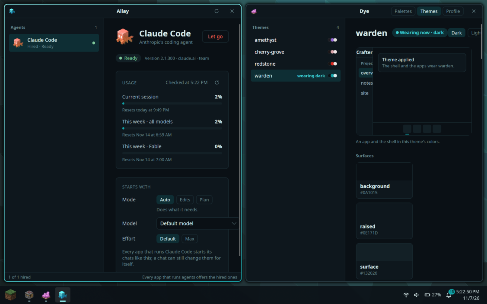
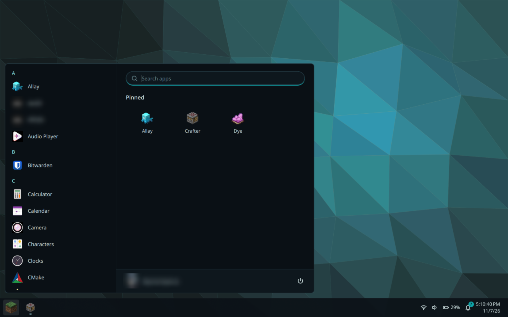
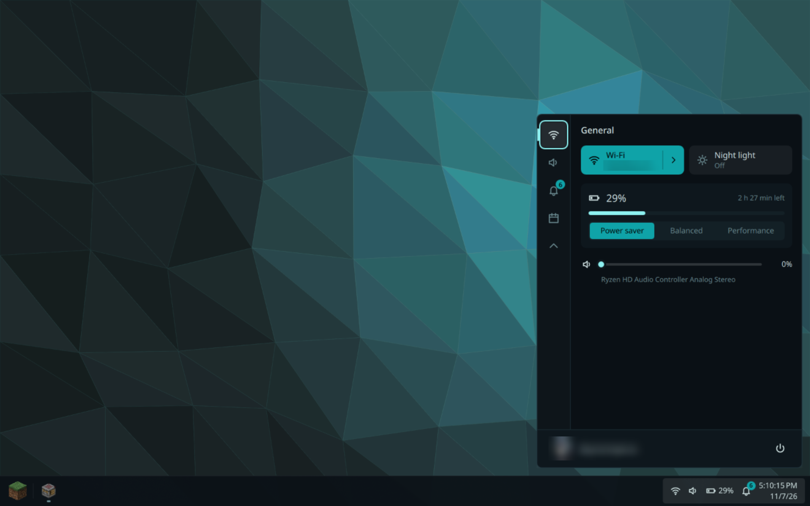
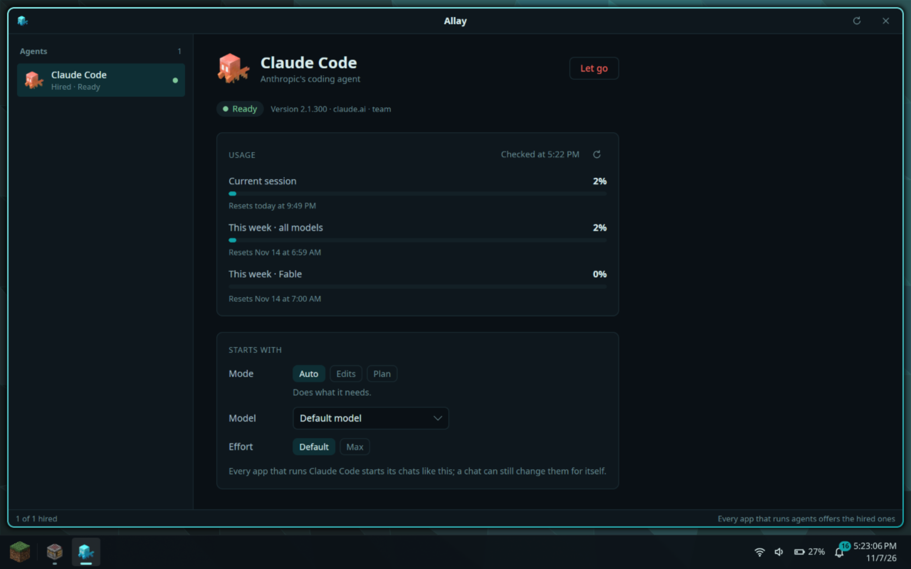
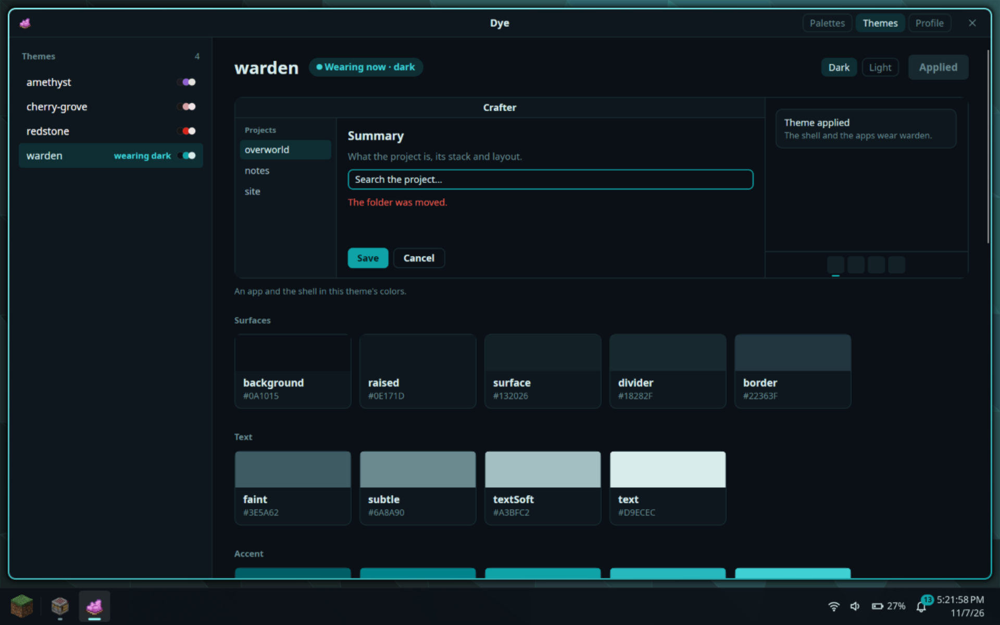

# Overworld

[](https://github.com/dayvsonspacca/overworld/actions/workflows/ci.yml)

A Linux desktop of its own, with AI agents woven through all of it. One look across the shell and every app, and agents that work alongside you and ask when they need you.



## The shell

The desktop itself: taskbar, start menu, control center, notifications, lock screen and screen captures.





## The apps

### Crafter

An app for coding with AI. Each project keeps the rules its agent follows, a summary, todos and a library of skills; each chat shows what the agent said, thought, planned and did, and lets you pick how it works, attach files and pictures and queue your next message.

### Allay

Where you hire the agents every app can use: see whether each is ready, choose how it starts and how much of your plan is used.



### Dye

Color palettes as swatches, and Overworld's themes: each one previewed in an app and the shell, and applied to the whole desktop in a click.



## Install

Overworld installs on **Arch Linux**. On a fresh machine:

```sh
curl -fsSL https://raw.githubusercontent.com/dayvsonspacca/overworld/main/scripts/install.sh | bash
```

Then log out and pick Hyprland at the login screen.

## Learn more

The [wiki](https://github.com/dayvsonspacca/overworld/wiki) goes deeper into each part of Overworld.

## License

[MIT](LICENSE)
